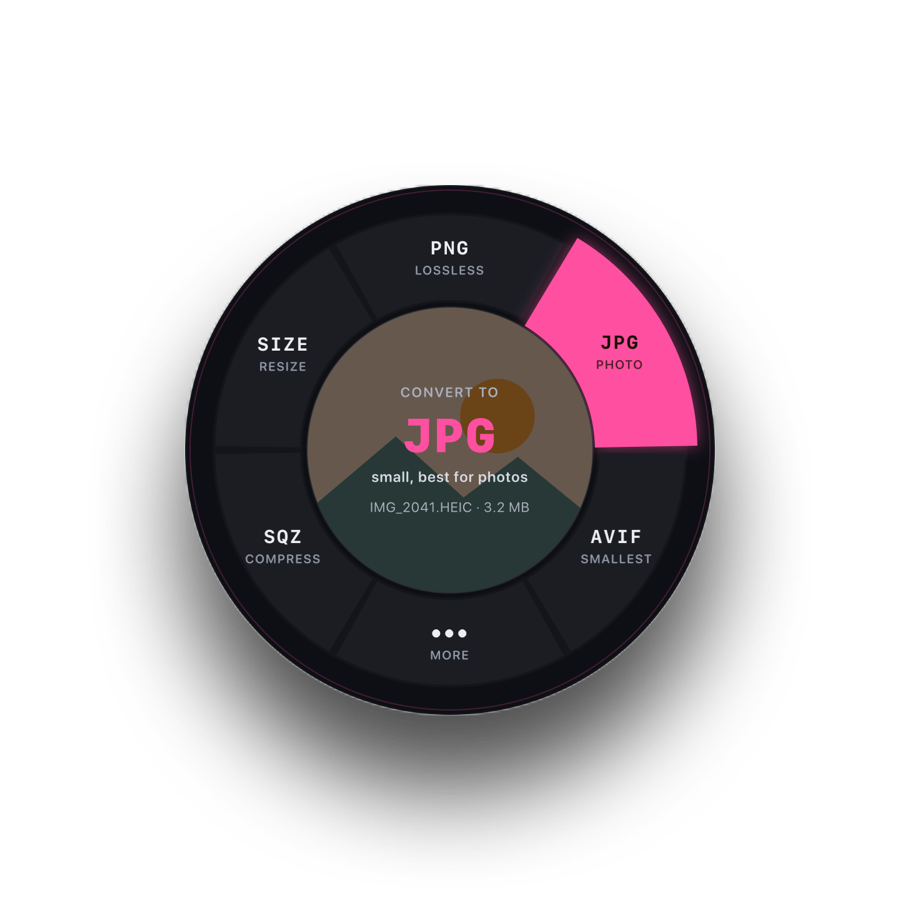
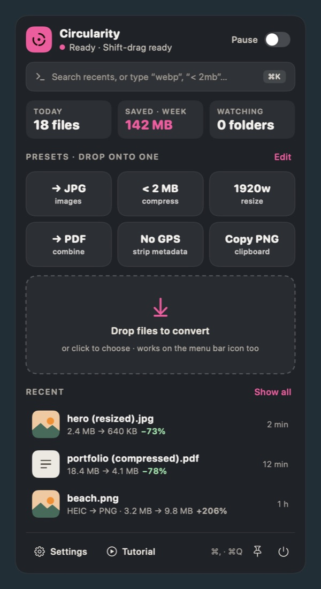
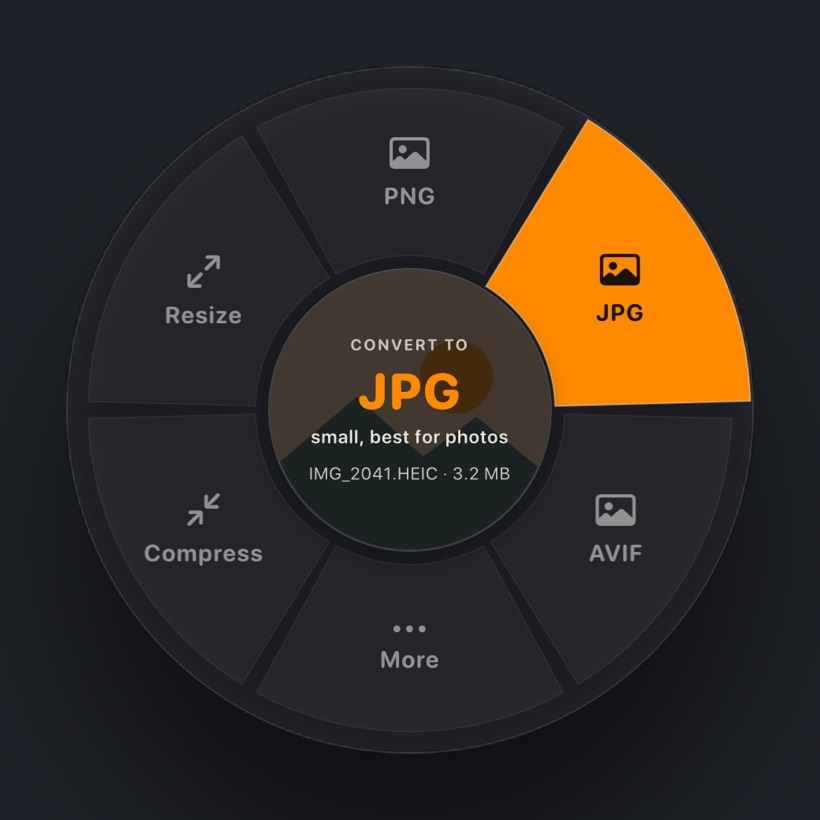
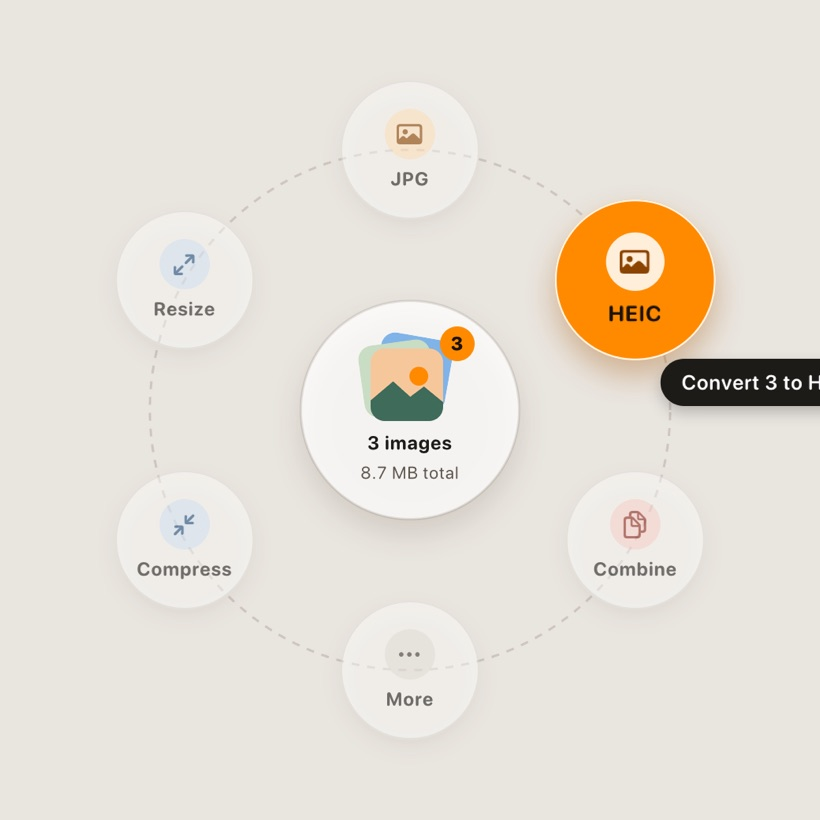
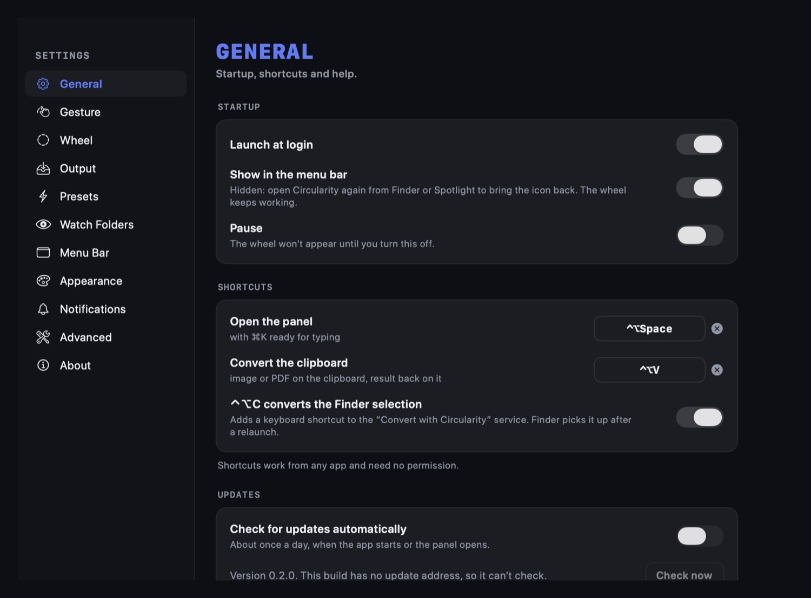

<p align="center">
  <picture>
    <source media="(prefers-color-scheme: dark)" srcset="docs/media/header-dark.svg">
    
  </picture>
</p>

<p align="center">
  <b>Convert files on your Mac without opening anything.</b><br>
  Drag a file, tap <b>Shift</b>, and a wheel of formats opens around your pointer. Let go on one.
</p>

<p align="center">
  <a href="https://circularity.pages.dev/"><b>Website</b></a> ·
  <a href="https://github.com/kunal12krishna/Circularity/releases/latest/download/Circularity.dmg"><b>Download for macOS</b></a> ·
  <a href="https://circularity.pages.dev/studio.html"><b>Wheel Studio</b></a>
</p>

<p align="center">
  
</p>

Circularity is a menu bar app for macOS. It converts images, PDFs, Word, Excel and PowerPoint files
right where you're dragging them, and the new file lands next to the original.

Everything happens on your Mac with Apple's own frameworks: your files are never uploaded, and the
original is never changed. (The only time Circularity goes online is the update check, and that's
off unless you turn it on; see [Privacy](#privacy).)

[](LICENSE)
[](https://circularity.pages.dev/)
[](https://github.com/kunal12krishna/Circularity/releases)
[](https://github.com/kunal12krishna/Circularity/releases)
[](https://circularity.pages.dev/)

Made by **[Kunal Krishna](https://github.com/kunal12krishna)**. Open source under the
[MIT licence](LICENSE). It's a one-person side project, so if something breaks or you have an idea,
I'd really like to hear about it.

## Where the idea came from

Circularity for Mac wouldn't exist without
[Circularity for Windows](https://github.com/AtharvGogia/Circularity-for-Windows) by Atharv Gogia
(MIT), which pops a wheel of formats up mid-drag on Windows, and without
[Tangerine](https://tangerineformac.com/) by LEAP STUDIO, where the idea of converting a file right
at your cursor started. Circularity is written from scratch in Swift for the Mac, and no code or
assets were copied, but the idea is theirs and the credit belongs to them. The Tangerine theme follows
the Tangerine design by LEAP STUDIO.

## Download

Get **`Circularity.dmg`** from the **[Releases page](https://github.com/kunal12krishna/Circularity/releases/latest)** (or the
[website](https://circularity.pages.dev/)), open it and drag **Circularity** onto **Applications**.
It runs on macOS 13 Ventura or later, on Apple silicon and Intel.

This early build isn't signed with an Apple Developer ID yet, so macOS asks before opening it the
first time. You only need to allow it once:

- **macOS 15 Sequoia and later:** open it once (macOS says it can't verify it; click **Done**),
  then go to **System Settings → Privacy & Security**, scroll down to the message about Circularity
  and click **Open Anyway**, then **Open**.
- **macOS 13 Ventura and 14 Sonoma:** in Applications, **right-click** (or Control-click)
  Circularity → **Open**, then click **Open** in the dialog.

After that it opens normally. It lives in the menu bar (no Dock icon). The first time it starts, a
short welcome shows you the gesture, and there's an interactive tutorial with a practice picture
whenever you want it.

## What it does

1. **Notices a file drag** from Finder, the desktop or any app. It needs no special permission:
   no Accessibility, no Input Monitoring, no Screen Recording, so macOS never asks.
2. **Opens the wheel** around your pointer when, mid-drag, you:
   - **tap Shift** (or Option or Control, your choice in Settings → Gesture; tap or hold),
   - **shake** the pointer left and right a few times, or
   - press **⌃⌥C** with files selected in Finder (turn it on in Settings → General), or use
     **Convert with Circularity** in Finder's Quick Actions / Services menu.

   Let go on a button to convert. Let go in the middle to cancel. The centre always says what the
   button you're on will do ("Convert to JPG · small, best for photos"), with a live size estimate.

   The ring holds **six buttons**, so each stays big enough to hit without looking. Everything else
   waits under **••• More**: rest on it and the rest fan out just outside the wheel. You choose which
   six sit on the ring for pictures.

   <p align="center">
     
   </p>

3. **Runs the job in the background**, two at a time:
   - **Images:** PNG, JPG, HEIC, AVIF, TIFF, GIF, BMP (and WebP where macOS can write it).
     **Compress** by quality or to a target size, **resize**, **crop** (a movable box with ratio
     locks), and **combine** several into one PDF.
   - **PDFs:** pages to images, text out, compress, resize to A4 / Letter or a scale, crop, combine.
   - **Documents:** Markdown, HTML and plain text to PDF and to each other.
   - **Documents from Office**, with nothing extra installed (no Office, no permission asked):
     - **Word:** DOCX / DOC / RTF / ODT → PDF, DOCX, TXT
     - **Excel:** XLSX / XLS / ODS / CSV → PDF (every sheet, on landscape pages fitted to the width,
       each under its name)
     - **PowerPoint:** PPTX / PPT / ODP → PDF (one page per slide, at the slide's own size)

     Word files go through macOS's `textutil`; Excel and PowerPoint files are laid out by macOS's own
     Office engine, the one Quick Look previews them with; OpenDocument and CSV files are read
     directly. Speaker notes are left out.
   - **Cut out** (macOS 14+): removes a photo's background with Apple's on-device subject lifting
     and saves a transparent PNG.

   <p align="center">
     
   </p>

4. **Puts the result next to the original** (or in a folder you choose in Settings → Output):
   `photo.png`, `photo (resized).jpg`, `scan (combined).pdf`, with ` (1)`, ` (2)`… if the name is
   taken. A half-finished file is never left behind, and the original is never touched unless you
   turn on "Move the original to the Trash".

### Small things that feel big

- **Drop shelf:** the result floats next to your pointer. Drag it straight into Mail, Slack or a
  chat, or copy it with one click.
- **Before and after:** hover JPG, HEIC or Compress and a magnifier shows a piece of your picture,
  half as it is and half as it will be.
- **Your own buttons:** tick "Also add this as a button" in the Resize or Compress window, and that
  exact resize or compression becomes a one-click button on the wheel.
- **Watch folders:** pick a folder and an action (say, Convert to JPG for Screenshots), and every
  new file that lands there gets it.
- **Clipboard conversion:** **⌃⌥V** converts the image or PDF on the clipboard and puts the result
  back.
- **Milestones:** your first conversion, 1 GB saved, 10,000 files. A small celebration in the menu
  bar each time.
- **A desktop widget** with today's conversions, space saved and recent files.

### The menu bar panel



Click the menu bar icon (or press **⌃⌥Space**) for the panel:

- **Presets** you can drop files on (→ JPG, < 2 MB, 1920w, → PDF, No GPS, Copy PNG)
- **⌘K**: type what you want, like `webp`, `< 2mb`, `1920w` or `no gps`, and it does it to the
  files you dropped
- **Drop zone**, **recent results** (Space for Quick Look), **history** and **stats**: files
  converted today, space saved this week, folders being watched
- **Pause**, and the gear for Settings

<br clear="right">

### Looks

Three wheel layouts (**Halo**, **Ring** and **Orbit**), built-in themes, and every knob from the
website's [Wheel Studio](https://circularity.pages.dev/studio.html): fill style (flat, duotone,
shades, stickers, rainbow, outline), second colour, disc, text and rim colours, rounded corners,
glow, hover pop, label weight and spacing, and motion (breathe, orbiting dots, twirl, sparks).
Build a wheel on the website, click **Copy for the app**, then in Circularity open
**Settings → Appearance → Paste theme**. A pasted theme replaces the whole look, so nothing from the
previous one is left behind.

<p align="center">
  
  
  
</p>

### Settings



Click the icon → the gear in the panel. Changes apply live.

- **General:** launch at login, show in the menu bar, pause, the shortcuts (⌃⌥Space, ⌃⌥V, ⌃⌥C),
  and update checks
- **Gesture:** which key opens the wheel, tap or hold, a delay, shake and its sensitivity, apps
  and full-screen spaces where it stays out of the way, and a picture to practise on
- **Wheel:** layout, which buttons go on the ring for pictures, smart ordering, how long to rest on
  More, the before/after close-up, sounds and the opening animation
- **Output:** where results go, naming, what happens when a name is taken, metadata (keep, strip
  location, strip everything), and moving the original to the Trash
- **Presets**, **Watch Folders**, **Menu Bar**, **Appearance** (themes, Paste theme, Copy theme,
  Export theme), **Notifications**, **Advanced** and **About**

Export or import all your settings, or just the theme, as JSON.

## Privacy

Your files never leave your Mac. Circularity:

- needs **no special permission** (no Accessibility, no Input Monitoring, no Screen Recording)
- sees mouse movements only to notice a file drag, and reads the clipboard only when you press ⌃⌥V
- converts everything on your Mac with Apple's own ImageIO, PDFKit, Vision, WebKit, `textutil` and
  Quick Look's Office engine
- goes online for one thing only, the **update check**, which is **off unless you turn it on**
  (Settings → General). It downloads one small JSON file and sends nothing but a
  `User-Agent: Circularity/<version>` header (see [docs/UPDATES.md](docs/UPDATES.md)).

It idles at 0.02 % CPU and sleeps until you drag a file.

## Build from source

Requirements: macOS 13+ to run; Xcode 27 to build (tested with 27.2),
[XcodeGen](https://github.com/yonaskolb/XcodeGen) and, for the DMG,
[create-dmg](https://github.com/create-dmg/create-dmg).

```sh
brew install xcodegen create-dmg
scripts/bootstrap.sh          # generates Circularity.xcodeproj
open Circularity.xcodeproj
```

| Script | What it does |
| --- | --- |
| `scripts/build.sh` | Release build, universal, stripped, ad-hoc signed with the hardened runtime → `dist/Circularity.app` |
| `scripts/dmg.sh` | `dist/Circularity-<version>.dmg` with the background and an Applications link |
| `scripts/dmg-arm64.sh` | Apple silicon-only build and DMG |
| `scripts/sign.sh` | Developer ID signature, only when `DEVELOPER_ID_APP` is set (otherwise it says so and does nothing) |
| `scripts/notarize.sh` | Notarise and staple the DMG, only when `NOTARY_PROFILE` is set |
| `scripts/release.sh` | All of the above in order |
| `scripts/install.sh` | Installs the Release app into /Applications on this Mac and opens it (`--fresh` rebuilds it first) |
| `scripts/clean-rebuild.sh` | Deletes the Debug build and caches (keeps `dist/` and the installed app), rebuilds a test copy and opens it (`--test` runs all tests, `--reset` erases settings too) |
| `scripts/build-website.sh` | The public website in `website/public/` (`--with-dmg` puts the DMG inside, for Cloudflare Pages) |

## Test it

```sh
scripts/clean-rebuild.sh --test
```

runs everything below in one go.

- `xcodebuild -scheme Circularity test`: the unit tests.
- The `EngineSmokeTest` target: every conversion through the real engine, including the Word,
  Excel and PowerPoint samples in `Tests/Fixtures/office` (`SMOKE_KEEP=<folder>` keeps their PDFs;
  `SMOKE_OFFICE_EXTRA=<folder>` converts your own files too).
- `Circularity.app/Contents/MacOS/Circularity --drag-test`: the real wheel, panel, settings and
  jobs (the wheel and windows flash briefly).
- `--check-themes Tests/Fixtures/studio-themes.json [folder]`: every Wheel Studio export (presets,
  random rolls and the ends of every range) pastes in intact, and pasting one over another leaves
  nothing of the old look behind. With a folder, each wheel is also rendered at rest and with More
  open.
- `--render-previews <folder>`: renders the wheels, panel, settings and dialogs to PNGs.
- `--perf-report [file.md]`: measures the app's performance budgets on this Mac.

Manual checks are in [docs/MANUAL-TESTS.md](docs/MANUAL-TESTS.md), the release steps in
[docs/RELEASE-CHECKLIST.md](docs/RELEASE-CHECKLIST.md), and how to record the demo GIF in
[docs/DEMO-GIF.md](docs/DEMO-GIF.md).

## Known limits

These are the rough edges I know about.

- **Not notarised yet.** Until there's a Developer ID release, macOS asks before the first launch
  (see [Download](#download)).
- **No video or audio yet.** They're coming in the next version.
- **WebP** is only offered where macOS itself can write it. **Cut out** needs macOS 14 or later.
- **Excel and PowerPoint → PDF** use macOS's built-in Office engine, so a PDF looks like the file's
  Quick Look preview rather than exactly like Office: on busy slides a shape can be missing, and fonts
  you don't have are swapped for the nearest Mac font (Calibri → Helvetica Neue). Password-protected
  files can't be opened. ODP slides keep their text, boxes and pictures, but not gradients, lines or
  animations.
- **Update checks** need a feed address set at build time (`UPDATE_FEED_URL`, see
  [docs/UPDATES.md](docs/UPDATES.md)); a build without one says so in Settings and never goes
  online. For now, new versions are on the [Releases page](https://github.com/kunal12krishna/Circularity/releases).

## How it's put together

| Folder | What's in it |
| --- | --- |
| `Sources/Engine` | The conversion engine: a job queue (two at a time) with progress and cancellation, ImageIO / PDFKit / WebKit backends, Word through `textutil`, Excel and PowerPoint through macOS's Office engine (`OfficeBackend`) and OpenDocument read directly (`OpenDocument`), Cut out (Vision), size estimates, output naming, and atomic writes so a failed job leaves nothing behind. |
| `Sources/AppLogic` | Pure, unit-tested logic: the wheel's geometry and menu, the gesture state machine and shake detector, ⌘K parsing, presets, themes and colour contrast. |
| `Sources/App/Gesture` | Watches for file drags and decides, once per drag, whether the wheel may open. |
| `Sources/App/Wheel` | The wheel window and its three renderers (Ring and Halo in `SectorRenderer`, Orbit in `OrbitRenderer`), the look resolved from settings (`WheelStyle`), motion, sounds and the before/after loupe. |
| `Sources/App/MenuBar` | The menu bar icon and the panel (presets, ⌘K, drop zone, recent results). |
| `Sources/App/Dialogs` | Resize, Compress and Crop. |
| `Sources/App/Settings` | The Settings window, and Paste theme for Wheel Studio themes. |
| `Sources/App/Extras` | Drop shelf, watch folders, clipboard conversion, notifications, Quick Look, the widget bridge. |
| `Sources/App/Platform` | Global shortcuts, launch at login, the Finder service, one running copy, update checks. |
| `Sources/App/Onboarding` | The welcome and the tutorial. |
| `Sources/App/Diagnostics` | `--drag-test`, `--check-themes`, `--render-previews`, `--perf-report` and the developer HUD. |
| `Sources/Widget` | The desktop widget. |
| `website/` | The website ([circularity.pages.dev](https://circularity.pages.dev/)) and the Wheel Studio. |
| `design/` | The design boards the app is drawn from. |

## Publishing a release

Releases are built and published by hand, and the website links to the newest one.

1. Bump `MARKETING_VERSION` and `CURRENT_PROJECT_VERSION` in `Config/Base.xcconfig`, and add the
   release to the changelog in `website/index.html`.
2. Run the tests (`scripts/clean-rebuild.sh --test`), then `scripts/release.sh` →
   `dist/Circularity-x.y.z.dmg`.
3. Commit, push, and publish the DMG under the fixed name `Circularity.dmg`, so the
   "latest" download link never changes:
   ```sh
   cp dist/Circularity-x.y.z.dmg dist/Circularity.dmg
   gh release create vx.y.z dist/Circularity.dmg --title "Circularity x.y.z" --notes-file notes.md
   ```
4. `scripts/build-website.sh` (its Download button points at
   `releases/latest/download/Circularity.dmg`), then upload `website/public/` to Cloudflare Pages:
   `npx wrangler pages deploy website/public --project-name circularity`.

The download count on this page comes from GitHub Releases.

## Feedback

Circularity is still young, and it gets better every time someone tells me what tripped them up. If
something doesn't work, or you have an idea, please
[open an issue](https://github.com/kunal12krishna/Circularity/issues). "It would be nice if…" is
just as welcome as a bug.

## Licence

Circularity is open source under the [MIT licence](LICENSE). It ships no third-party code: it uses
only frameworks that come with macOS; see [THIRD-PARTY-NOTICES.md](THIRD-PARTY-NOTICES.md).

Thanks for reading, and for trying Circularity.
