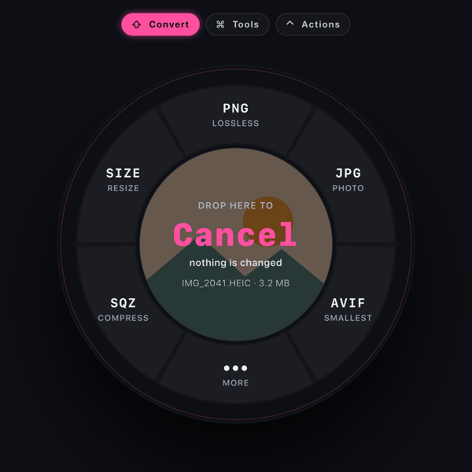
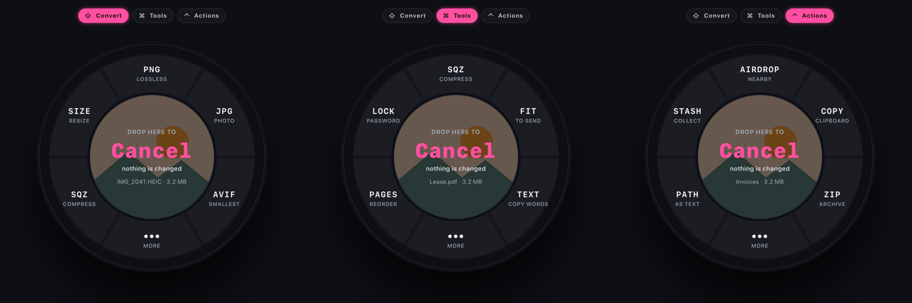
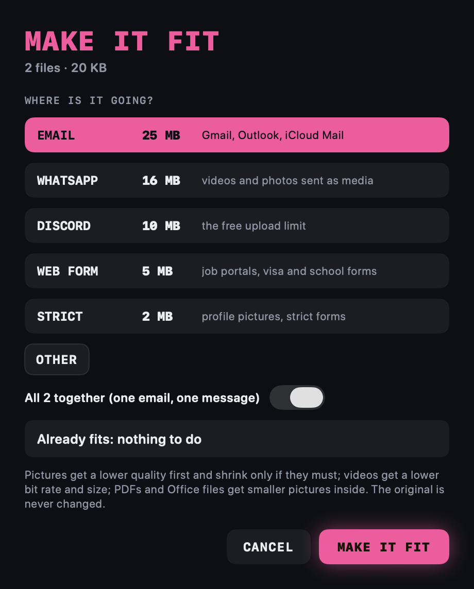
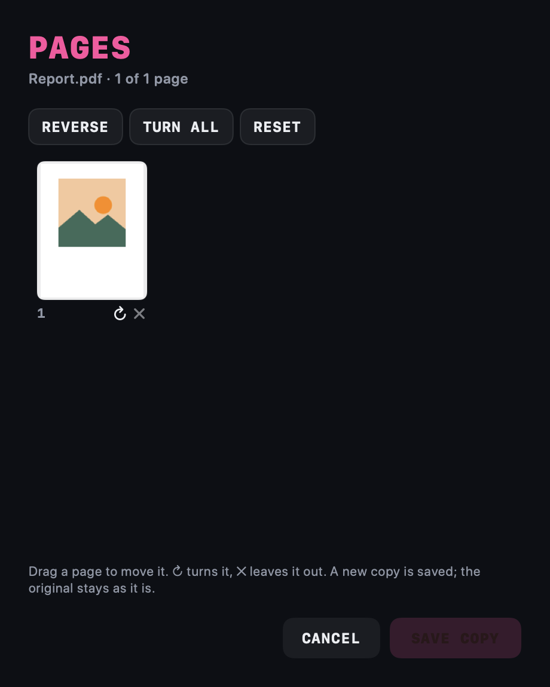
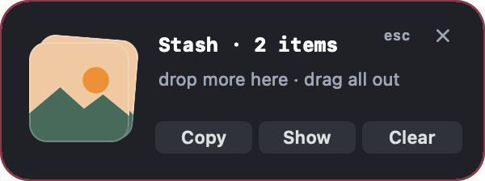
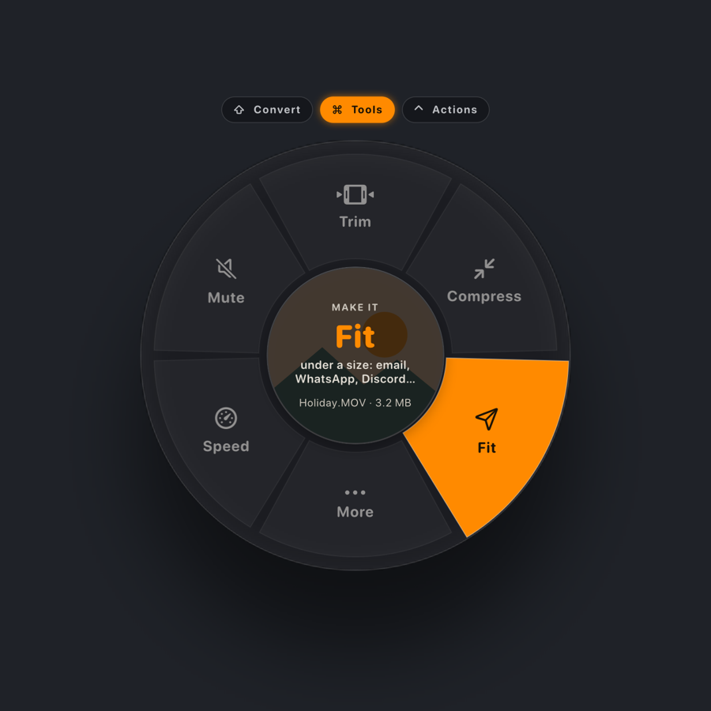

<p align="center">
  <picture>
    <source media="(prefers-color-scheme: dark)" srcset="docs/media/header-dark.svg">
    
  </picture>
</p>

<h3 align="center">Drag a file. Tap a key. Done.</h3>

<p align="center">
  A free, open-source file converter for the Mac that lives under your pointer.<br>
  HEIC → JPG, video → GIF, shrink a PDF for email, pull text out of a screenshot,<br>
  without opening an app, uploading anything, or leaving the window you're in.
</p>

<p align="center">
  <a href="https://github.com/kunal12krishna/Circularity/releases/latest/download/Circularity.dmg"><b>⬇︎ Download for macOS</b></a> ·
  <a href="https://circularity.pages.dev/"><b>Website</b></a> ·
  <a href="https://circularity.pages.dev/studio.html"><b>Wheel Studio</b></a> ·
  <a href="#-everything-it-does"><b>Features</b></a>
</p>

<p align="center">
  <a href="LICENSE"></a>
  <a href="https://circularity.pages.dev/"></a>
  <a href="https://github.com/kunal12krishna/Circularity/releases"></a>
  <a href="https://github.com/kunal12krishna/Circularity/releases"></a>
  
  
</p>

<p align="center">
  
</p>

---

## The idea

You're dragging a photo into an email and it's a 9 MB HEIC. Normally that's: open an app, export,
pick a format, find the file, drag again. Or worse: a converter website full of ads that wants your
file first.

With Circularity you just **tap a key while you're still dragging**. A wheel opens around your
pointer. Let go on what you want, and the new file appears next to the original, ready to drop
wherever you were going.

There are **three wheels**, one per key, and keycaps above the wheel always show which is which:

<p align="center">
  
</p>

| Key | Wheel | For |
| :-: | --- | --- |
| **⇧ Shift** | **Convert** | Formats: JPG, PNG, HEIC, AVIF, PDF, MP4, MOV, GIF, M4A, WAV, FLAC… |
| **⌘ Command** | **Tools** | Compress, **Make it fit**, **Text from anything**, Crop, Resize, Trim, Speed, Pages, Lock… |
| **⌃ Control** | **Actions** | AirDrop, Copy, Zip, Copy path, **Stash**, Mail, Terminal, Move to… *(works on folders too)* |

Tap another key while the wheel is open and it switches in place. Every key can be changed or
turned off in Settings.

## Why not just use a website?

| | Online converters | Opening an app | **Circularity** |
| --- | :-: | :-: | :-: |
| Your file stays on your Mac | ✗ | ✓ | **✓** |
| No account, no ads, no file-size limit | ✗ | ✓ | **✓** |
| Works mid-drag, in any app | ✗ | ✗ | **✓** |
| Images, PDFs, Office, video *and* audio | some | rarely all | **✓** |
| "Make this fit in an email" in one step | ✗ | ✗ | **✓** |
| Free and open source | sometimes | sometimes | **✓** |

## ✦ Everything it does

### 🎯 Make it fit
Tell it where the file is going (**Email 25 MB, WhatsApp 16 MB, Discord 10 MB, a web form 5 MB,
or any size**) and it finds the *smallest change* that gets under the limit. Photos get a lower
quality first and shrink only if they must; videos get a lower bit rate and size; PDFs and Office
files get smaller pictures inside. Several files can share one limit, like one email with five
attachments. Photos come out as JPG (PNG if they're see-through), so they open on anyone's computer.

<p align="center"></p>

### 🔤 Text from anything
**Tools → Text** reads the words in a screenshot, a photo of a sign or a scanned PDF and puts them on
your clipboard. **OCR** makes a scanned PDF searchable and selectable. It all runs on Apple's
on-device text recognition, in the languages your Mac uses.

### 🎬 Video and audio
MOV ↔ MP4 ↔ M4V in seconds (no re-encoding when the codecs allow it), **video → GIF**, the sound
alone as M4A / WAV / AIFF / FLAC, **Trim** with the same handles as QuickTime, **Compress** to HEVC
(HDR stays HDR), **Speed** from 0.25× to 4× with voices keeping their pitch, **Mute**, and **Join**
several clips into one. Hover a button and the wheel tells you roughly how big the result will be;
hover GIF and a preview plays in the middle.

### 📄 PDFs
Pages to images, compress (every page checked against the original), resize to A4/Letter, crop,
combine, **split** into one PDF per page, **lock with a password or unlock**, and **Pages**:
drag to reorder, turn or remove pages, then save a copy.

<p align="center"></p>

### 🖼 Images
PNG, JPG, HEIC, AVIF, TIFF, GIF, BMP and WebP (where macOS can write it). Compress by quality or to
a target size, resize, crop with ratio locks, combine into a PDF, **remove the background**
(macOS 14+), and **strip location data** before you share. Hover JPG or HEIC to see a before/after
close-up of your own photo.

### 📑 Word, Excel, PowerPoint
DOCX, DOC, RTF, ODT, XLSX, XLS, ODS, CSV, PPTX, PPT and ODP → PDF with nothing extra installed, plus
**Compress** that resamples the pictures inside like Office's own *Compress Pictures*.

### ⚡ Actions, for any file or folder
AirDrop, Copy (pastes as a file in Finder and as a picture in chats), **Zip** (clean archives,
no `__MACOSX` clutter), Copy path, **Stash** (collect files from different folders, then drag them all
out at once), Mail, open in Terminal, Move to…, Copy to…, Quick Look, Show in Finder.

<p align="center">
  
  &nbsp;
  
</p>

### ↩︎ The result card, and Undo for everything
After each job a small card floats by your pointer: drag the result straight into Mail or Slack, see
how much smaller it got, or **Undo** it. **Esc** closes it, and a ring shows when it'll leave on its own.
Undo also works later from the menu bar panel. It brings back an original that went to the Trash
and moves files back where they came from.

### 🎨 Make it yours
Three layouts (**Halo**, **Ring**, **Orbit**), built-in themes, and the
[**Wheel Studio**](https://circularity.pages.dev/studio.html): design a wheel in your browser,
click *Copy for the app*, paste it into Settings → Appearance.

<p align="center">
  
  &nbsp;
  
</p>

<details>
<summary><b>And a few more things</b></summary>

- **Shake to open**: shake the pointer mid-drag instead of tapping a key.
- **⌃⌥C** or Finder's **Quick Actions → Convert with Circularity** opens the wheel on selected files.
- **⌃⌥V** converts the image or PDF on your clipboard and puts the result back.
- **Watch folders**: every new screenshot becomes a JPG, automatically.
- **Your own buttons**: tick "Also add this as a button" in Resize or Compress.
- **⌘K** in the menu bar panel: type `webp`, `< 2mb`, `1920w`, `mp4` or `no gps`.
- A desktop widget, milestones, sounds and haptics, and a full Settings window with live preview.

</details>

## 🔒 Privacy is the point

**Your files never leave your Mac.** No uploads, no account, no analytics.

- Needs **no special permission**: no Accessibility, no Input Monitoring, no Screen Recording.
- Converts with Apple's own frameworks (ImageIO, PDFKit, AVFoundation, Vision, WebKit,
  `textutil`, Quick Look's Office engine). No bundled FFmpeg, nothing downloaded.
- Goes online for one thing only, the **update check**, which is **off unless you turn it on**.
- Idles at 0.02 % CPU and sleeps until you drag a file.

## ⬇︎ Install

Get **[Circularity.dmg](https://github.com/kunal12krishna/Circularity/releases/latest/download/Circularity.dmg)**,
open it and drag Circularity to Applications. macOS 13 Ventura or later, Apple silicon and Intel.

This build isn't signed with an Apple Developer ID yet, so macOS asks once:

- **macOS 15 and later:** open it once (click **Done**), then **System Settings → Privacy & Security →
  Open Anyway → Open**.
- **macOS 13 and 14:** right-click Circularity in Applications → **Open** → **Open**.

It lives in the menu bar. A short welcome shows you the gesture, with a practice picture.

## FAQ

<details>
<summary><b>Does it replace my original?</b></summary>
Never, unless you switch on "Move the original to the Trash". Results are saved next to the
original as <code>photo.jpg</code>, <code>photo (compressed).jpg</code>, <code>clip (trimmed).mp4</code>…
and a half-finished file is never left behind.
</details>

<details>
<summary><b>Will ⌘ or ⇧ interfere with normal Finder drags?</b></summary>
No. A key you're already holding when the drag starts (Finder's ⌘-drag to move, say) is ignored until
you let go and tap it again. You can change every key, add a delay, or exclude apps.
</details>

<details>
<summary><b>Which video formats?</b></summary>
It reads whatever macOS can play (MOV, MP4, M4V, 3GP, MP3, M4A, WAV, AIFF, FLAC…) and writes MP4,
MOV, M4V, GIF, M4A, WAV, AIFF and FLAC. It doesn't bundle FFmpeg, so it can't write WebM, MKV, MP3 or
OGG.
</details>

<details>
<summary><b>Is it really free?</b></summary>
Yes, MIT-licensed, no trial, no account. If it saves you a trip to a converter website,
<b>a ⭐ helps other people find it</b>.
</details>

## Known limits

- **Not notarised yet**: the one-time "Open Anyway" step above, until there's a Developer ID release.
- **Excel and PowerPoint → PDF** use macOS's built-in Office engine: a PDF looks like the file's
  Quick Look preview, so on busy slides a shape can be missing. Password-protected Office files can't
  be opened.
- **WebP** is offered only where macOS can write it; **Cut out** needs macOS 14.

## Contributing

Bug reports and ideas are very welcome: [open an issue](https://github.com/kunal12krishna/Circularity/issues).
"It would be nice if…" counts. To build it yourself, see
**[docs/DEVELOPMENT.md](docs/DEVELOPMENT.md)**:

```sh
brew install xcodegen create-dmg
scripts/bootstrap.sh && open Circularity.xcodeproj
```

## Where the idea came from

Circularity for Mac wouldn't exist without
[Circularity for Windows](https://github.com/AtharvGogia/Circularity-for-Windows) by Atharv Gogia
(MIT), which pops a wheel of formats up mid-drag on Windows, and without
[Tangerine](https://tangerineformac.com/) by LEAP STUDIO, where the idea of converting a file right
at your cursor started. Circularity is written from scratch in Swift, with no code or assets copied,
but the idea is theirs and the credit belongs to them. The Tangerine theme follows the Tangerine
design by LEAP STUDIO.

## Star history

<a href="https://star-history.com/#kunal12krishna/Circularity&Date">
  
</a>

---

<p align="center">
  Made by <a href="https://github.com/kunal12krishna"><b>Kunal Krishna</b></a> · <a href="LICENSE">MIT</a> ·
  uses only frameworks that come with macOS (<a href="THIRD-PARTY-NOTICES.md">notices</a>)<br>
  <sub>If Circularity saved you a few minutes, star the repo. It's the best way to help.</sub>
</p>
