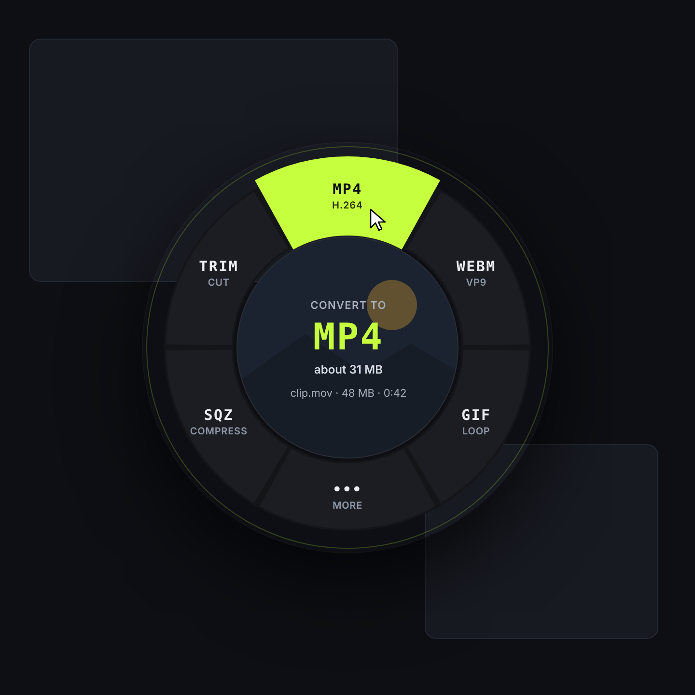

# Circularity

Convert files on your Mac without opening anything. Start dragging a file,
tap **Shift**, and a wheel of formats appears around the pointer. Let go on
one and the new file appears next to the original.



- **Images:** PNG, JPG, HEIC, AVIF, TIFF, GIF, BMP (and WebP where macOS can
  write it), compress (by quality or to a target size), resize, crop, combine
  into one PDF.
- **PDFs:** pages to images, text out, compress, resize to A4/Letter or a
  scale, crop, combine.
- **Documents:** Markdown, HTML, RTF, Word and plain text to PDF and to each other.
- A **menu bar panel** with presets you can drop files on, ⌘K commands
  (`webp`, `< 2mb`, `1920w`, `no gps`), recent results, history and stats.
- **Watch folders**, **clipboard conversion** (⌃⌥V) and **⌃⌥C** for the Finder
  selection.
- Three wheel looks (Halo, Ring, Orbit), themes, and a full Settings window.

Video and audio are coming in the next version.

## Install

1. Download `Circularity-<version>.dmg` (or `…-arm64.dmg`, smaller, for Apple silicon only).
2. Open it and drag **Circularity** onto **Applications**.
3. Open Circularity from Applications.

### The first launch

Until there is a Developer ID release, Circularity is signed *ad hoc*, so
macOS can't check it with Apple and stops it the first time. You only need to
allow it once:

- **macOS 15 Sequoia and later:** open it once (macOS says it can't verify
  it — click **Done**), then go to **System Settings → Privacy & Security**,
  scroll down to the message about Circularity and click **Open Anyway**,
  then **Open**.
- **macOS 13 Ventura and 14 Sonoma:** in Applications, **right-click**
  (or Control-click) Circularity → **Open**, then click **Open** in the dialog.

After that it opens normally. It lives in the menu bar (no Dock icon).

## Use

| Do | What happens |
|---|---|
| Drag a file and tap **Shift** (or shake the pointer) | The wheel opens. Let go on a format; let go in the middle to cancel. |
| Rest on **••• More** | More formats and tools fan out. |
| Click the menu bar icon | The panel: presets, ⌘K, drop zone, recent results. |
| **⌃⌥Space** | The panel with ⌘K ready for typing. |
| **⌃⌥V** | Converts the image or PDF on the clipboard. |
| **⌃⌥C** in Finder | Converts the selected files (turn it on in Settings → General). |
| Click the icon → the gear in the panel | Everything else: themes, shortcuts, output folder and naming, presets, watch folders… |

Results are written next to the original (or a folder you choose in
Settings → Output). Originals are never changed unless you turn on "Move the
original to the Trash".

## Privacy

Circularity needs no special permission: no Accessibility, no Input
Monitoring, no Screen Recording. Nothing is uploaded; the only network use is
the update check, which is off unless you turn it on (Settings → General). It sees mouse movements only to
notice a file drag, reads the clipboard only when you press ⌃⌥V, and converts
everything on your Mac with Apple's own frameworks.

## Build from source

Requirements: macOS 13+ to run; Xcode 27 to build (tested with 27.2), [XcodeGen](https://github.com/yonaskolb/XcodeGen)
and, for the DMG, [create-dmg](https://github.com/create-dmg/create-dmg)
(`brew install xcodegen create-dmg`).

```sh
scripts/bootstrap.sh     # generates Circularity.xcodeproj
open Circularity.xcodeproj
```

| Script | Does |
|---|---|
| `scripts/build.sh` | Release build, universal, stripped, ad-hoc signed with the hardened runtime → `dist/Circularity.app` |
| `scripts/dmg.sh` | `dist/Circularity-<version>.dmg` with the background and an Applications link |
| `scripts/dmg-arm64.sh` | Apple silicon-only build and DMG |
| `scripts/sign.sh` | Developer ID signature — only when `DEVELOPER_ID_APP` is set, otherwise it says so and does nothing |
| `scripts/notarize.sh` | Notarise and staple the DMG — only when `NOTARY_PROFILE` is set |
| `scripts/release.sh` | All of the above in order |
| `scripts/install.sh` | Installs the Release app into /Applications on this Mac and opens it (`--fresh` rebuilds it first) |
| `scripts/clean-rebuild.sh` | Deletes the Debug build and caches (keeps `dist/` and the installed app), rebuilds a test copy and opens it (`--test` runs all tests, `--reset` erases settings too) |
| `scripts/build-website.sh` | The public website in `website/public/` (`--with-dmg` puts the DMG inside, for Cloudflare Pages) |

Tests: `xcodebuild -scheme Circularity test` (unit tests), the
`EngineSmokeTest` target (every conversion through the real engine), and
`Circularity.app/Contents/MacOS/Circularity --drag-test` (the real wheel,
panel, settings and jobs), and `--check-themes Tests/Fixtures/studio-themes.json`
(every Wheel Studio export, presets, rolls and extremes, pastes in intact, and
pasting one over another leaves nothing of the old look behind; with a folder
after the file it also renders each wheel, rest and More fan open). Manual checks are in `docs/MANUAL-TESTS.md`; the
release steps in `docs/RELEASE-CHECKLIST.md`.

## Recording a demo GIF

A short checklist for the README/website GIF (QuickTime → New Screen Recording, then convert with Gifski or `ffmpeg`):

1. Clean desktop, Dark Mode, a photo on the desktop, Circularity set to Halo.
2. Record a 600 × 600 area around the photo, about 8 seconds.
3. Drag the photo a little → tap Shift → hover JPG (the centre says "Convert to JPG") → let go.
4. The new file appears next to the photo; the menu bar icon pulses once.
5. Second take: hover ••• More so the fan opens, let go on Compress, show the dialog.
6. Export at 30 fps, ≤ 5 MB; check the cursor is visible and nothing personal is on screen.

## Credits

Inspired by Circularity for Windows by Atharv
Gogia (MIT). The Tangerine look is after the Tangerine design by LEAP STUDIO.

MIT licence — see [LICENSE](LICENSE) and [THIRD-PARTY-NOTICES.md](THIRD-PARTY-NOTICES.md).
